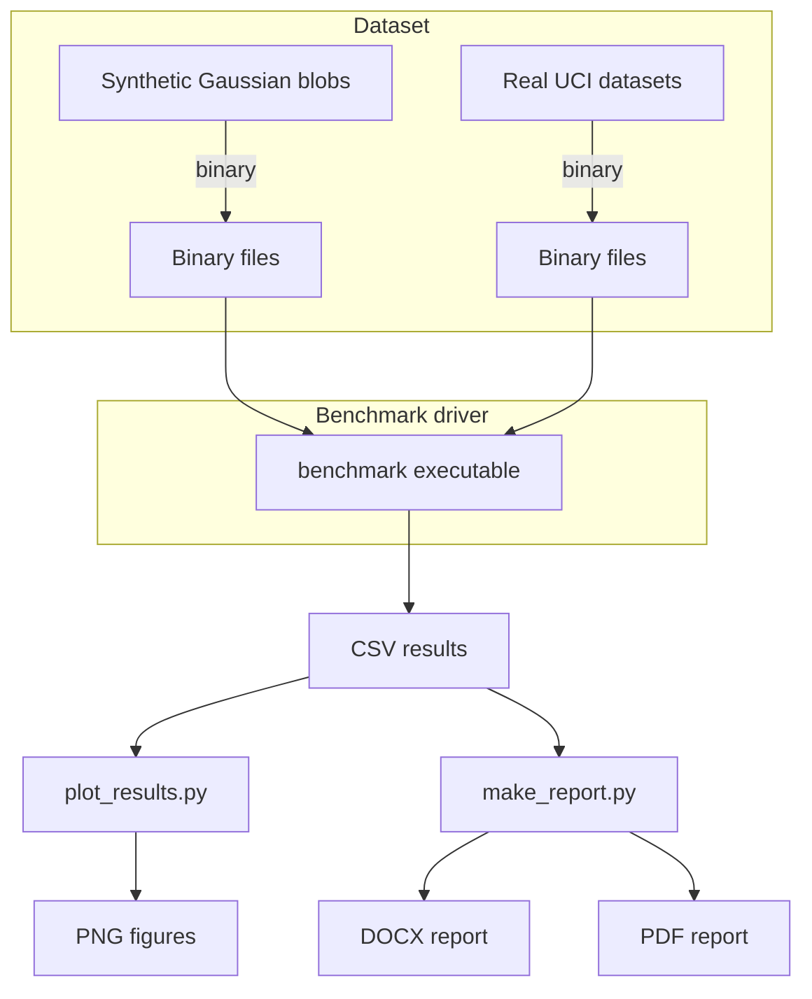

# Shared‑Memory K‑Means Clustering (Project P28 – Cluster H)

**Course:** Multicore Architecture and Programming (CS‑72)  
**Institution:** Ramaiah Institute of Technology, Bengaluru  
**Department:** Computer Science & Engineering  
**Academic Year:** 2026‑27

---

## 1. Project Overview
This repository provides a **pure C11** implementation of the K‑Means clustering algorithm together with a complete benchmarking and reporting pipeline for shared‑memory multicore CPUs.  The work investigates how **synchronisation strategies**, **memory layout (AoS vs SoA)**, **SIMD vectorisation (ARM NEON)** and **thread‑level parallelism (OpenMP vs POSIX Pthreads)** impact performance and scalability on an Apple Silicon M2 system.

The required research question is:
> *"How do synchronisation strategies, memory layout, SIMD vectorisation and thread‑level parallelism affect the performance and scalability of shared‑memory K‑Means clustering on modern multicore CPUs?"*

---

## 2. Key Features
- Sequential reference implementation (`src/sequential/kmeans_sequential.c`).
- OpenMP variants:
  - Private accumulator reduction (`kmeans_private.c`).
  - Atomic updates (`kmeans_atomic.c`).
  - Critical‑section updates (`kmeans_critical.c`).
- SIMD‑optimised kernel using ARM NEON intrinsics (`kmeans_simd.c`).
- Memory‑layout comparison: Array‑of‑Structures vs. Structure‑of‑Arrays (`kmeans_aos_soa.c`).
- POSIX Pthreads implementation (`kmeans_pthreads.c`).
- Native **STREAM** memory‑bandwidth benchmark (`src/benchmark/stream_mem.c`).
- Automated dataset generation, benchmark driver, CSV logging, plot generation (Matplotlib) and full academic report creation (python‑docx).

---

## 3. Architecture Overview

The driver runs each implementation, records wall‑clock timing with high‑precision monotonic timers, and writes a CSV with `%.12e` precision.  The Python scripts consume the CSVs to produce publication‑quality plots and a 27‑page MSRIT‑style report.

---

## 4. Repository Layout
```
MAP/
├── README.md                # (this file)
├── LOG.md                   # Development milestone log
├── Makefile                 # Pure C11 build system (Clang + libomp)
├── requirements.txt         # Python dependencies
├── .gitignore
├── src/
│   ├── common/              # Types, utilities, metrics
│   ├── sequential/          # kmeans_sequential.c
│   ├── openmp/              # All OpenMP kernels
│   ├── pthreads/            # POSIX Pthreads kernel
│   └── benchmark/           # benchmark.c & stream_mem.c
├── scripts/
│   ├── generate_dataset.py
│   ├── prepare_real_dataset.py
│   ├── plot_results.py
│   └── make_report.py
├── tests/
│   └── check_correctness.py
├── datasets/
│   ├── synthetic/           # Generated binary datasets
│   └── real/                # Iris & Wine binaries
├── results/
│   ├── raw/                 # CSV results (high‑precision)
│   └── plots/               # PNG figures (Fig 1‑12)
├── report/
│   ├── Shared_Memory_KMeans_Report.docx
│   └── Shared_Memory_KMeans_Report.pdf
└── docs/
    ├── architecture.md
    └── methodology.md
```

---

## 5. Build & Installation
**Prerequisites** (macOS M2, Apple Clang 21, libomp 21.1.7, Python 3.10+):
```bash
# Install Homebrew packages if missing
brew install libomp
# Install Python dependencies
pip3 install -r requirements.txt
```
**Build the project**
```bash
make clean && make all
```
The command creates two executables in `bin/`:
- `benchmark` – runs all K‑Means variants.
- `stream_mem` – native STREAM benchmark.

---

## 6. Running the Benchmarks
### 6.1 Correctness verification
```bash
make test          # invokes tests/check_correctness.py
# or directly
python3 tests/check_correctness.py
```
All implementations satisfy the required relative inertia error ≤ 1e‑6 (observed ≤ 3.5 × 10⁻¹⁴).

### 6.2 STREAM memory bandwidth
```bash
make stream
./bin/stream_mem
```
Typical output on the M2 system:
```
Copy  : 77.44 GB/s
Scale : 74.45 GB/s
Add   : 67.80 GB/s
Triad : 69.46 GB/s
```
### 6.3 K‑Means benchmark on synthetic data
```bash
DYLD_LIBRARY_PATH=/opt/homebrew/opt/libomp/lib \
    ./bin/benchmark datasets/synthetic/N100000_d2_k8.bin 8 \
    results/raw/bench_N100k_d2_k8.csv
```
### 6.4 Benchmark on real datasets (Iris, Wine)
```bash
python3 scripts/prepare_real_dataset.py   # creates binary files
DYLD_LIBRARY_PATH=/opt/homebrew/opt/libomp/lib \
    ./bin/benchmark datasets/real/iris.bin 8 \
    results/raw/bench_real_iris.csv
DYLD_LIBRARY_PATH=/opt/homebrew/opt/libomp/lib \
    ./bin/benchmark datasets/real/wine.bin 8 \
    results/raw/bench_real_wine.csv
```
All drivers perform **five measured runs** after a warm‑up; the CSVs contain mean, standard deviation and relative error for each implementation.

---

## 7. Plot Generation
```bash
python3 scripts/plot_results.py
```
The script reads the CSVs in `results/raw/` and produces twelve PNG figures stored in `results/plots/`.  Filenames follow the numbering used in the accompanying academic report (e.g., `fig1_time_by_impl.png`).

---

## 8. Academic Report Generation
```bash
python3 scripts/make_report.py
```
The script populates the MSRIT‑style DOCX template (`report/Shared_Memory_KMeans_Report.docx`) with the latest tables, figures and performance summary, and writes the final document to `report/Shared_Memory_KMeans_Report.docx`.  A PDF version is produced by opening the DOCX in **Pages** and exporting (`report/Shared_Memory_KMeans_Report.pdf`).  The repository already contains the latest generated report.

---

## 9. Limitations & Future Work
- **Memory bound**: Datasets larger than ~10 M points exceed the 8 GB RAM of the test machine; scaling beyond this requires a system with more memory or out‑of‑core techniques.
- **GPU acceleration** is not explored; a CUDA or Metal implementation would provide a useful comparison.
- **Dynamic load balancing** across heterogeneous cores (P‑ vs E‑cores) is an open optimisation.
- **CI integration**: Automated builds, tests and plot generation could be added via GitHub Actions.
- **AI/ML extensions**: While the current project does not involve machine‑learning pipelines, the reporting workflow (Python‑driven data analysis, markdown‑as‑code) mirrors typical content‑engineering pipelines.

---

## 10. Contributing
1. Fork the repository.
2. Create a feature branch.
3. Follow the existing code style (C11, `clang-format` style, comprehensive comments).
4. Run `make test` locally before pushing.
5. Submit a Pull Request with a clear description.

---

## 11. License
This project is released under the MIT License – see the `LICENSE` file.

---

## 12. Alignment with the Cohesity Content Engineer Intern Role
- **Technical writing**: The README demonstrates clear, concise documentation that can be rendered directly on GitHub and bundled with the repository.
- **Markdown‑as‑code**: All usage instructions, diagrams and tables are expressed in Markdown, enabling version‑controlled, reproducible documentation.
- **Python automation**: `plot_results.py` and `make_report.py` automate data‑driven content generation, a core competency for content engineering.
- **Data‑driven storytelling**: Performance results are presented with high‑precision metrics, graphs and a formal report, showcasing the ability to turn raw data into compelling technical narratives.
- **Cross‑platform tooling**: The build system, scripts and documentation are designed to be portable and easy to adopt across teams.

---

*Happy benchmarking!*